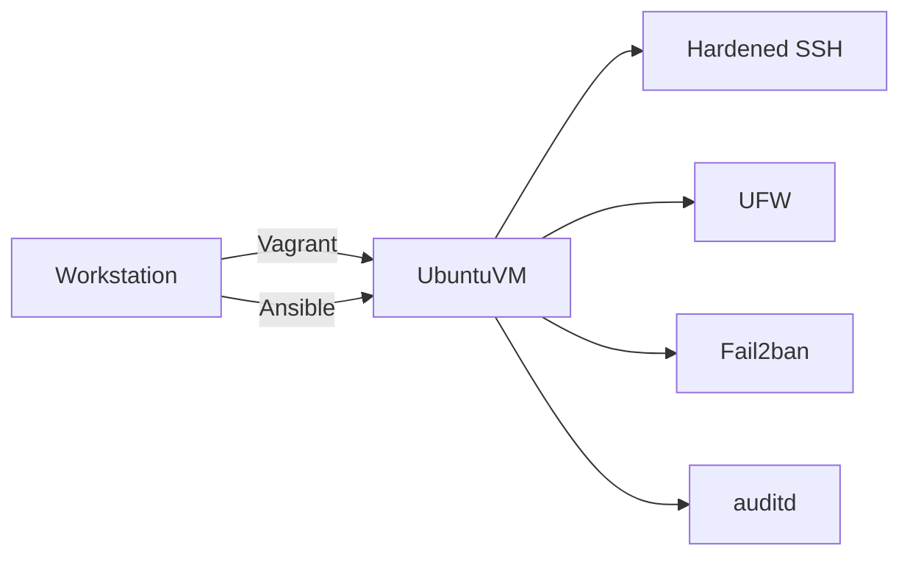

# Secure Linux Homelab

A reproducible, disposable Ubuntu server-hardening lab built with Vagrant and Ansible.
It demonstrates practical Linux administration, configuration management, and defensive
security controls without requiring a cloud account or storing credentials in Git.

> Status: first working milestone. The project currently implements a secure baseline;
> automated integration tests and monitoring will be added in later milestones.

## What this project demonstrates

- Reproducible infrastructure for a local learning environment
- Modular Ansible roles and idempotent configuration
- Key-only SSH and disabled direct root login
- Default-deny host firewall policy
- Brute-force mitigation with Fail2ban
- Linux audit rules for security-sensitive files
- Automatic security updates
- CI checks for YAML, Ansible, syntax, and accidental secrets
- Operational documentation and recovery procedures

## Architecture



See [the architecture notes](docs/architecture.md) for the trust boundaries and design
decisions.

## Repository layout

```text
.
├── .github/workflows/       # CI quality and secret checks
├── docs/                    # Architecture and operational runbook
├── inventory/               # Static-check inventory only
├── playbooks/               # Ansible entry points and safe defaults
├── roles/                   # Independent hardening controls
├── Vagrantfile              # Disposable Ubuntu VM
└── requirements.yml         # Required Ansible collections
```

## Prerequisites

- Python 3.11+
- Ansible Core
- Vagrant
- VirtualBox

No cloud credentials, API tokens, passwords, or personal SSH keys are required.

## Quick start

```bash
make install
make lint
make syntax-check
make validate
make up
make verify
```

Destroy the disposable VM after the lab:

```bash
make destroy
```

## Safe configuration

The committed defaults contain only generic values. `opsadmin` is a lab account name,
not a personal identity. The SSH public key variable is empty and must remain empty in
the public repository.

For a non-Vagrant test VM, inject a public key at runtime:

```bash
export LAB_PUBLIC_KEY="$(ssh-keygen -y -f /path/to/a-local-test-private-key)"
ansible-playbook -i /path/to/local-inventory playbooks/site.yml \
  --extra-vars "homelab_admin_public_key=${LAB_PUBLIC_KEY}"
unset LAB_PUBLIC_KEY
```

Never print, pass, or commit the private key itself. Read [SECURITY.md](SECURITY.md)
before adapting the project to another environment.

## Validation

Run static checks before provisioning:

```bash
make lint
make syntax-check
make validate
```

After provisioning, verify the security controls:

```bash
make verify
```

The detailed recovery and troubleshooting procedures are in
[the operations runbook](docs/runbook.md).

The latest local integration results, including the zero-change idempotency run, are
recorded in [the validation evidence](docs/validation.md).

## Security decisions

| Risk | Control |
| --- | --- |
| Password guessing | Key-only SSH and Fail2ban |
| Direct privileged access | Root SSH disabled; named admin account with sudo |
| Unnecessary inbound access | Default-deny UFW policy |
| Missed security patches | unattended-upgrades |
| Untracked configuration changes | auditd watch rules |
| Accidental credential commit | `.gitignore` rules and Gitleaks in CI |

## Limitations

- The baseline is intentionally small and is not a formal compliance benchmark.
- The default workflow targets a local disposable VM, not a production server.
- Availability, centralized logging, backups, and monitoring are not implemented yet.
- Disabling password authentication on an existing server requires verified key access
  and an out-of-band recovery path.

## Planned milestones

- Molecule-based role tests
- node_exporter and a small monitoring profile
- encrypted backup exercise
- optional Docker host role with an explicit security discussion
- incident-response exercise and post-incident report template

## License

The license will be selected before the repository is published.

