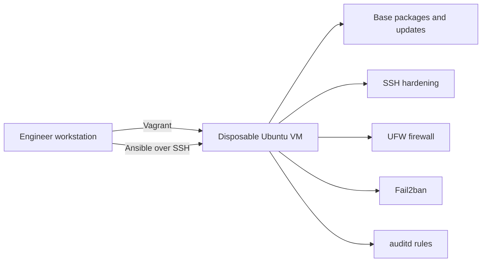

# Architecture

The workstation is the control node. Vagrant creates an isolated learning VM and
generates temporary connection data. Ansible then configures the VM through small,
independent roles.

No cloud account, public server, credential, or personal SSH key is required for the
default lab workflow.

## Security boundaries

- The VM is disposable and should not hold valuable data.
- Password authentication and direct root SSH login are disabled.
- UFW denies unsolicited inbound connections by default.
- Fail2ban reacts to repeated SSH authentication failures.
- auditd records changes to selected identity, privilege, and SSH files.
- CI checks syntax, style, and accidental secret exposure.

This is an educational baseline, not a claim of CIS, PCI DSS, ISO 27001, or other
formal compliance.

